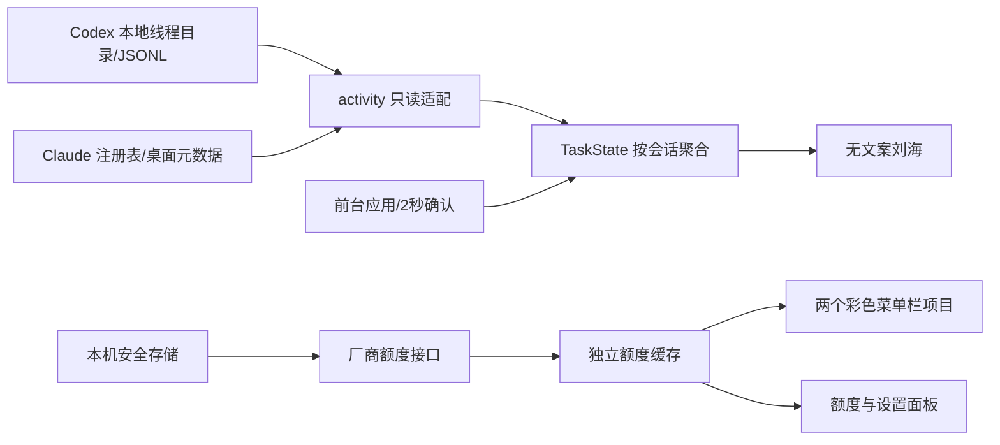

# 架构

Electron 主进程持有文件读取、网络请求、安全存储和原生窗口；两个隔离 renderer 仅接收白名单 DTO，不能读磁盘或取得令牌。

## 模块

- `src/main/activity.js`：2 秒串行状态扫描；5 秒缓存 Codex 候选目录，SQLite 最多 128 条、总候选最多 256。读取文件限制在 Codex sessions 根目录，Claude 注册记录有大小上限和 PID/启动时间检查。
- `src/main/state.js`：会话级状态机、启动历史抑制、完成已读和活动过期，不混入 token 账单逻辑。
- `src/main/quotas.js`：有限厂商域名的只读额度请求；不启动 CLI 探测、不刷新厂商令牌。状态请求与额度请求独立，扫描不会触发频繁联网。
- `src/main/index.js`：独立窗口和菜单栏生命周期、300ms 前台检测、显示器/锁屏处理、IPC 所有者验证。
- `src/main/store.js`：独立 `Mac Notch/settings.json`，手工凭据使用 safeStorage 加密；public DTO 不包含密钥。
- `src/main/layout.js`：从 AppKit safeArea 得到硬件摄像头区域，固定翼宽。没有沿用原应用的动态内容扩宽或下方文案实验。
- `src/vendor/token-monitor`：有限的 MIT 复用代码，保留目录结构以便追踪来源。DSH 两个文件仅用于压缩帧解析，不启用 DSH 客户端。

## 数据及网络边界

只读取自己的两类客户端本机数据。问题内容可能在解析本地 JSONL 时进入主进程内存，但不写入新日志、不传给 renderer、不上传服务器。界面仅得到 provider/state/count、额度窗口和非敏感设置。

应用没有遥测、远程代码、自动更新服务器。网络仅到 `api.anthropic.com`、`claude.ai`、`chatgpt.com`。禁用请求重定向，防止携带凭据跨站。默认使用系统代理，配置代理不会修改全局设置或两个工具的网络。

窗口启用 contextIsolation、sandbox、CSP、禁用 nodeIntegration，拒绝导航与新窗口。启动客户端只从内置 bundle ID 白名单选择。

## 未实现的能力

没有会话级深链、远程 Agent 状态、所有原生权限弹窗检测、自动登录令牌续期、永久任务数据库。客户端协议变化可能导致状态退回空闲或额度显示错误，必须用真实版本回归。
