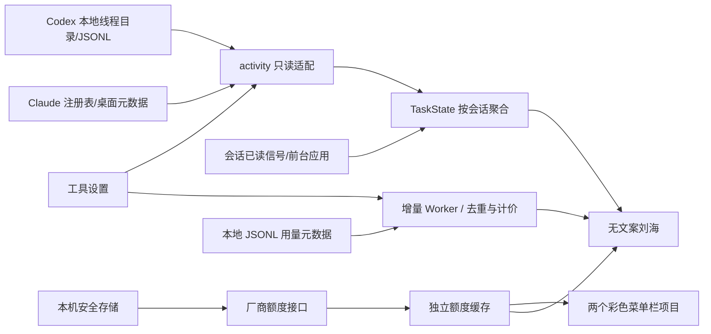

# 架构

Electron 主进程持有文件读取、网络请求、安全存储和原生窗口；两个隔离 renderer 仅接收白名单 DTO，不能读磁盘或取得令牌。

## 模块

- `src/main/activity.js`：2 秒串行状态扫描；5 秒缓存 Codex 候选目录，SQLite 最多 128 条、总候选最多 256。读取文件限制在 Codex sessions 根目录，Claude 注册记录有大小上限和 PID/启动时间检查。
- `src/main/state.js`：会话级状态机、独立多任务批次、部分完成统计与活动过期。提醒消除仍逐条使用 provider + session ID；具体会话已读或该工具持续前台访问都可触发。
- `src/main/quotas.js`：有限厂商域名的只读额度请求；不启动 CLI 探测、不刷新厂商令牌。状态请求与额度请求独立，扫描不会触发频繁联网。
- `src/main/index.js`：刘海收起/展开的同一窗口、居中设置窗口和菜单栏生命周期、1 秒前台与会话已读检测、显示器/锁屏处理、IPC 所有者验证。
- `src/main/store.js`：独立 `Mac Notch/settings.json`，手工凭据使用 safeStorage 加密；public DTO 不包含密钥。
- `src/main/layout.js`：从 AppKit safeArea 得到硬件摄像头区域；普通状态使用基础翼宽，多任务计数按需扩宽两侧。通知与用量面板在同一窗口中展开，保留摄像头区域。
<!--
- `src/vendor/token-monitor`：有限的 MIT 复用代码，保留目录结构以便追踪来源。DSH 两个文件仅用于压缩帧解析，不启用 DSH 客户端。
-->

## 数据及网络边界

只读取自己的两类客户端本机数据。问题内容可能在解析本地 JSONL 时进入主进程内存，但不写入新日志、不传给 renderer、不上传服务器。状态和用量界面接收 provider/state/count、额度窗口、按小时或日期汇总的数字和非敏感设置。完成通知另外接收会话标题和最多 400 字符的本轮纯文本摘要，不渲染 HTML，不上传内容。用量文件在独立 Worker 中流式读取，消息正文不进入界面，也不持久化第二份。

应用没有遥测、远程代码、自动更新服务器。网络仅到 `api.anthropic.com`、`claude.ai`、`chatgpt.com`。禁用请求重定向，防止携带凭据跨站。默认使用系统代理，配置代理不会修改全局设置或两个工具的网络。

窗口启用 contextIsolation、sandbox、CSP、禁用 nodeIntegration，拒绝导航与新窗口。启动客户端只从内置 bundle ID 白名单选择。

## 未实现的能力

Codex 已读来自本机 `electron-thread-read-state-v1` 的 local 线程未读变化；Claude 已读来自对应桌面会话的 `lastFocusedAt` 增长，并要求发生在完成之后。另外，`createVisitAttention` 将对应工具持续处于前台至少 1 秒视为工具级提醒已看到，清除该工具已有的完成提醒，包括无需更新聚焦时间的重复访问与已在前台的完成。该规则不是客户端已读回执，不会写入客户端文件，运行中和待协助状态不受影响。

完成通知支持经格式校验的 Claude / Codex 会话深链，缺少有效 ID 时只打开客户端；客户端版本可能影响跳转。没有远程 Agent 状态、所有原生权限弹窗检测、自动登录令牌续期、永久任务数据库。客户端协议变化可能导致状态退回空闲或额度显示错误，必须用真实版本回归。

- `usage-worker.js`：每 30 秒扫描可用本地记录；内存维护文件偏移和数字元数据，不落盘会话正文。
- `usage.js` / `pricing.js`：请求去重、累计差值、日历日汇总、标准 API 费用估算与未计价覆盖率。
